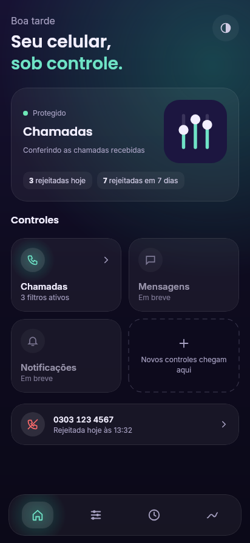
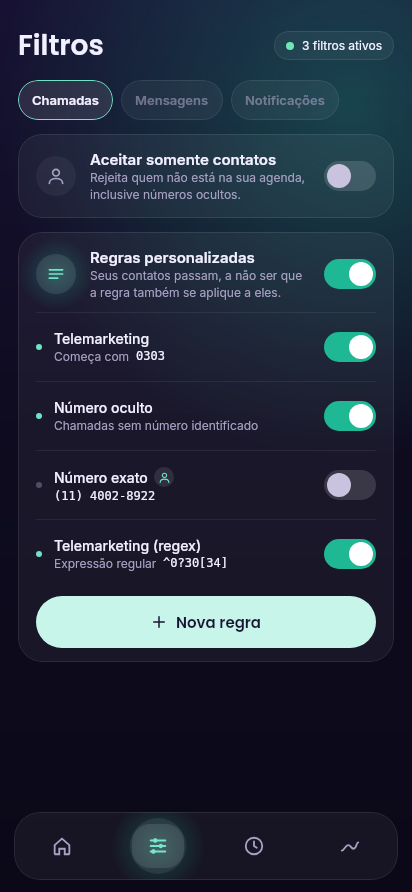
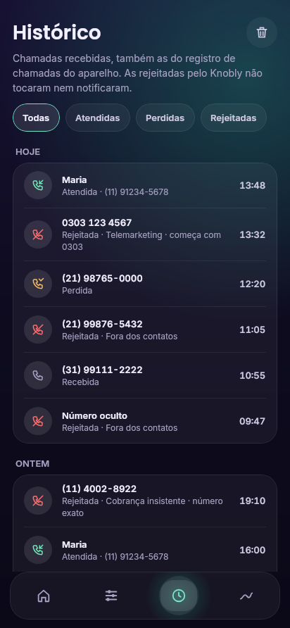
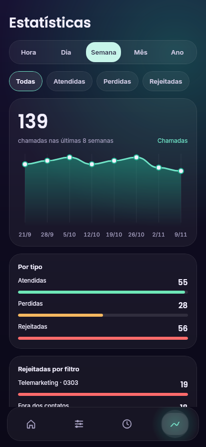
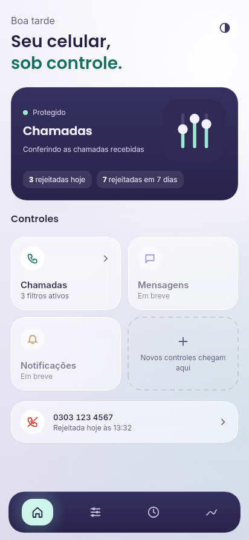
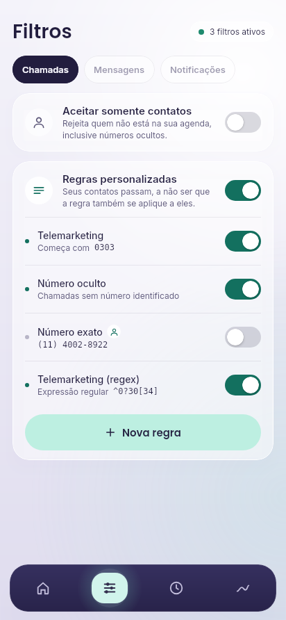
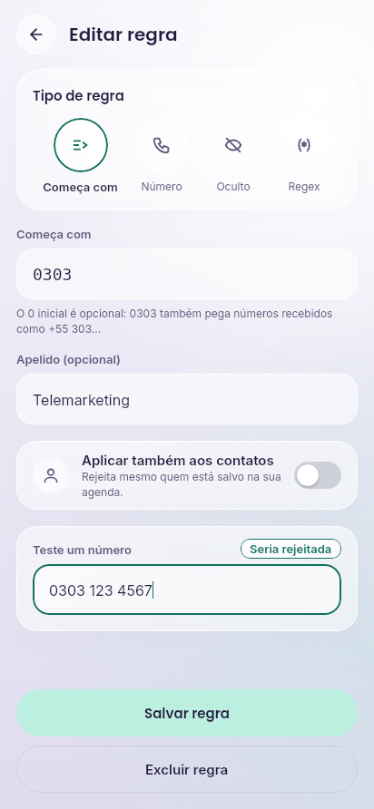
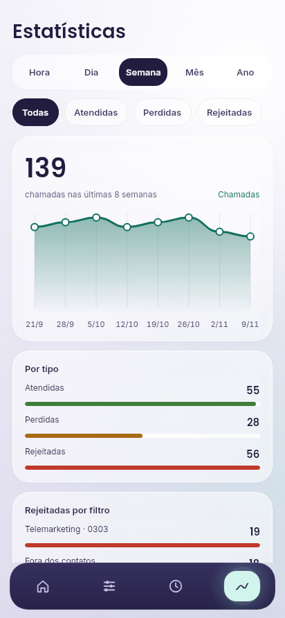

<p align="center">
  
</p>

<h1 align="center">Knobly</h1>

<p align="center">
  <strong>Your phone, under your control.</strong><br>
  A free, ad-free and open source call filter for Android, and the start of a utilities platform for your phone.
</p>

<p align="center">
  Android 10+ · No ads · No account · No tracking · Português and English
</p>

---

## Why Knobly

Telemarketing, robocalls and scams are a daily problem in Brazil, and the apps that fight them are usually paid, full of ads, or send your calls and contacts to a server.

Knobly takes a different approach: **you** decide which calls ring, with simple filters you switch on and off, and **everything stays on your phone**. A rejected call never rings or shows a notification. You can still review it later in Knobly's history.

Calls are the first feature. Knobly is built as a **control center for the phone**, so more controls (messages, notifications and others) can be added as modules later.

## Screenshots

<table>
  <tr>
    <td align="center"></td>
    <td align="center"></td>
    <td align="center"></td>
    <td align="center"></td>
  </tr>
  <tr>
    <td align="center"><sub><b>Home</b>: status at a glance</sub></td>
    <td align="center"><sub><b>Filters</b>: you decide what rings</sub></td>
    <td align="center"><sub><b>History</b>: every incoming call</sub></td>
    <td align="center"><sub><b>Statistics</b>: what the filters did</sub></td>
  </tr>
  <tr>
    <td align="center"></td>
    <td align="center"></td>
    <td align="center"></td>
    <td align="center"></td>
  </tr>
  <tr>
    <td align="center"><sub>Light theme</sub></td>
    <td align="center"><sub>Light theme</sub></td>
    <td align="center"><sub><b>Rule editor</b>: test a number before saving</sub></td>
    <td align="center"><sub>Light theme</sub></td>
  </tr>
</table>

<sub>The screenshots show the app in Portuguese (pt-BR) with sample data. They are taken from the app's screenshot tests (`./gradlew :app:shared:recordRoborazziJvm`).</sub>

## Features

### Call filters

- **Contacts only:** reject every call from a number that is not in your contacts, including hidden numbers.
- **Custom rules** that you can pause, edit and delete:
  - **Starts with:** block a whole prefix, such as `0303` (telemarketing) or `0304` (donations).
  - **Exact number:** block one specific number.
  - **Hidden number:** block calls without caller ID.
  - **Regular expression** (advanced): for patterns that a prefix cannot express.
- **Apply to contacts too:** a rule can also reject numbers saved in your contacts. This is off by default, so your contacts are always safe unless you choose otherwise.
- **Test a number** in the rule editor to see whether it would be rejected before you save the rule.
- **Smart number matching for Brazil:** numbers match with or without `+55`, the DDD area code, the 9th digit or the leading `0`. A contact saved as `91234-5678` is recognized when `+55 11 91234-5678` calls.
- **Invisible rejection:** a rejected call does not ring, does not show a notification and does not leave a "missed call".

### History

- Every incoming call with how it ended: **answered**, **missed** or **rejected**, plus the filter that rejected it.
- Contact names, filters by outcome, and call details.
- Optional: with call log access, Knobly also brings in calls from before it was installed and calls blocked by the system or other apps.
- Kept for as long as you want: delete single calls or the whole history whenever you like.

### Statistics

- Calls per **hour, day, week, month and year**, and per outcome.
- **Rejections per filter**, so you can see which rules actually work.
- Home shows today's and the last 7 days' rejections, and the latest rejected call.

### Look and feel

- Dark ("Noturno") and light ("Noturno Partido") themes. The app follows the system theme, or you can pick one yourself.
- Available in Portuguese and English.

## Privacy

Knobly is private by design, not by promise:

- **Your data never leaves your phone.** Contacts, call history and filters are never sent anywhere. Any future feature that uses the network will be optional and will say what it does ([ADR-0011](docs/adr/0011-network-access-for-optional-features.md)).
- **No analytics, telemetry, ads or accounts.**
- **No cloud backup** of your data (`android:allowBackup="false"`).
- Your filters, history and statistics are stored only on your phone.
- **Open source:** anyone can check what the code does.

## Requirements

| | |
|---|---|
| **Android** | 10 (API 29) or newer. No Google services needed. |
| **Call screening** | Knobly must be set as the phone's **call screening app** (Android asks you once). Your usual phone app stays the default dialer. |
| **iOS** | Not available yet (see [Platform support](#platform-support)). |

### Permissions

Knobly asks for a permission only when you turn on the feature that needs it:

| Permission | Required? | Used for |
|---|---|---|
| Call screening role | Yes, for filtering | Deciding whether an incoming call rings |
| Contacts (`READ_CONTACTS`) | Only for "contacts only" and to protect contacts from custom rules | Knowing whether a number is saved in your contacts |
| Call log (`READ_CALL_LOG`) | No | Showing whether calls were answered or missed, and bringing older calls into History |

## Platform support

Android gets the full feature set. iOS does not let apps decide on each call: it only accepts a static block list (Call Directory Extension), and contacts always take precedence. A future iOS version will therefore be limited to block lists and prefixes. See [Android vs iOS](docs/platforms.md) for the full comparison.

## Building from source

Requirements: JDK 21 and the Android SDK (platform 37). The repository includes a **devcontainer** with everything set up.

```bash
./gradlew :app:android:assembleDebug   # -> app/android/build/outputs/apk/debug/knobly-debug.apk
adb install -r app/android/build/outputs/apk/debug/knobly-debug.apk

./gradlew :app:desktop:run             # desktop harness with an incoming call simulator (no phone needed)
./gradlew check                        # tests, Detekt, ktlint and Android lint
```

The [development guide](docs/development.md) covers the devcontainer, the Android emulator, installing on a phone over Wi-Fi and iOS builds.

### Built with

[Kotlin Multiplatform](https://kotlinlang.org/docs/multiplatform.html) and [Compose Multiplatform](https://www.jetbrains.com/compose-multiplatform/) (shared UI for Android, iOS and a desktop development harness), Room, DataStore, Koin, Coroutines/Flow and libphonenumber. Filters are evaluated by a generic, pure-Kotlin rule engine that runs directly inside Android's `CallScreeningService`. See [architecture.md](docs/architecture.md).

## Contributing

Issues and pull requests are welcome. Before you start:

- Read [AGENTS.md](AGENTS.md) for the project's principles and conventions (it applies to humans too).
- Everything in the repository is written in English; UI text comes in English and Portuguese.
- Use [Conventional Commits](https://www.conventionalcommits.org/) (`feat:`, `fix:`, `docs:`…).
- UI changes come with a UI test or a screenshot test, and new filter rules come with rule engine tests.
- Run `./gradlew check` before opening a pull request.
- By contributing, you agree that your contribution is licensed under the AGPLv3 with the [app store exception](LICENSE-EXCEPTION.md).

## Documentation

- [Architecture](docs/architecture.md)
- [Android vs iOS](docs/platforms.md)
- [Development guide](docs/development.md): build, run without a phone, install on a phone
- [Visual identity](docs/design/visual-identity.md)
- Specs: [call filters](docs/specs/call-filters.md), [call history](docs/specs/call-history.md), [call statistics](docs/specs/call-statistics.md), [phone number matching](docs/specs/phone-number-matching.md), [appearance](docs/specs/appearance.md)
- [Architecture Decision Records](docs/adr/)

## Third-party assets

Fonts: [Poppins](https://github.com/itfoundry/Poppins) and [Inter](https://github.com/rsms/inter), both under the SIL Open Font License 1.1 (see [docs/licenses/fonts](docs/licenses/fonts/)).

## License

Knobly is free software, licensed under the [GNU Affero General Public License version 3](LICENSE) (AGPLv3), with an [additional permission](LICENSE-EXCEPTION.md) to publish it on app stores whose rules conflict with the AGPLv3, such as Apple's App Store. Anyone may use, study, change and share Knobly, as long as every version they distribute or offer over a network stays open under the same license. See [ADR-0012](docs/adr/0012-license-agplv3-with-app-store-exception.md) for the reasoning.

### Name and icon

The license covers the code, not the name "Knobly" or its icon. Forks are welcome, but please give them a different name and icon, so people always know which app they are installing.
