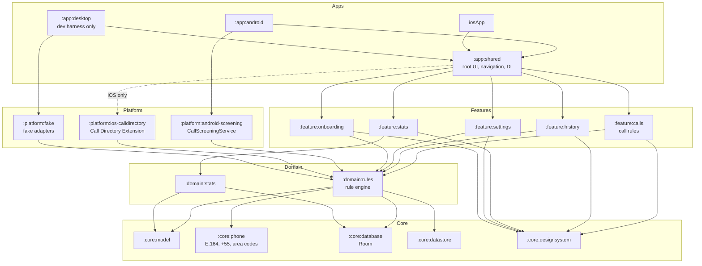
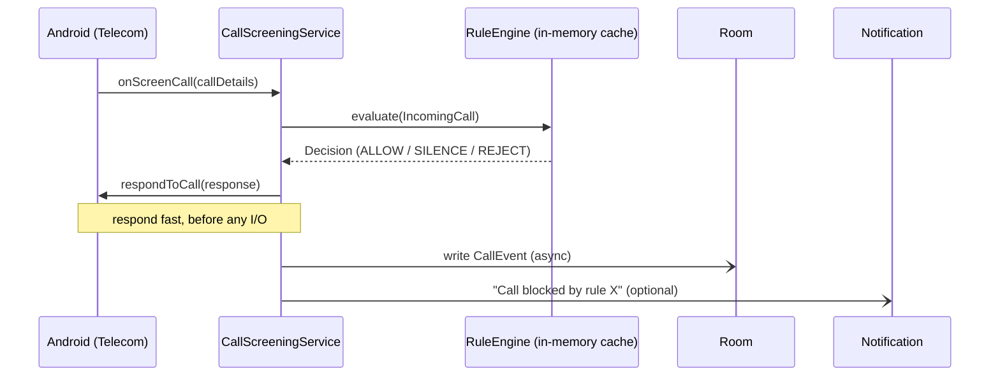

# Architecture

Knobly follows **Clean Architecture** with modularization by layer and by feature, using **Kotlin Multiplatform**.

## Principles

- **Dependencies point downwards:** apps → features → domain → core.
- **Features do not depend on each other.** Communication between features goes through the domain or through app navigation.
- **The domain is pure Kotlin**, with no platform APIs, and is 100% testable.
- **The app is a platform:** calls are the first feature; SMS and other controls come in as new `:feature:*` modules that reuse the rule engine.

## Modules



`:app:desktop` and `:platform:fake` exist only for development and tests; they are never part of a shipped app.

| Module | Responsibility |
|---|---|
| `:core:model` | Entities: `Rule`, `Event`, `IncomingCall`, `Decision`, `CallEvent` |
| `:core:phone` | Phone number normalization and comparison (E.164, +55, DDD area codes, 9th digit, hidden number) |
| `:core:database` | Room: DAOs, migrations, aggregation queries |
| `:core:datastore` | User preferences |
| `:core:designsystem` | Theme, colors, typography, reusable components |
| `:domain:rules` | Rule engine: evaluation, ordering, caching, rule repository |
| `:domain:stats` | Statistics use cases (aggregation by period) |
| `:feature:calls` | Screens to create, edit, reorder and enable call rules |
| `:feature:history` | List of filtered events |
| `:feature:stats` | Charts and dashboards |
| `:feature:settings` | General settings, backup, import/export |
| `:feature:onboarding` | Call filtering setup: the "Call filtering is off" card (shown in the Filters tab by `:app:shared`) that requests the call screening role; on iOS, guides the user to the native features |
| `:platform:android-screening` | `CallScreeningService` + block notifications |
| `:platform:ios-calldirectory` | Exports compatible rules as a list to the extension via App Group |
| `:platform:fake` | Fake adapters of the platform ports (contacts, role, incoming calls) for the desktop harness and tests |
| `:app:shared` | Root composable (`App`), bottom navigation, Koin graph; the iOS framework (`Shared`) consumed by `iosApp` |
| `:app:android` | Android application: `Application` (Koin), `MainActivity`, manifest, release signing |
| `:app:desktop` | Dev-only JVM app: runs the shared UI with fakes and an incoming call simulator |
| `iosApp` | Xcode project (SwiftUI shell hosting the shared Compose UI) |

## Targets

Shared modules (`:core:*`, `:domain:*`, `:feature:*`, `:platform:fake`) target **Android, iOS and JVM**. The JVM target powers the desktop harness and headless UI tests; see [ADR-0005](adr/0005-desktop-harness-and-platform-ports.md). Any shared library must support all three targets.

## Platform ports

Platform capabilities are accessed only through interfaces (ports) defined in the domain, so features, the engine and the UI can run anywhere:

```kotlin
// Implemented (domain/rules, package app.knobly.domain.port)
interface ScreeningRoleController {
    val isRoleAvailable: Boolean
    val isRoleHeld: StateFlow<Boolean>
    suspend fun requestRole(): Boolean
}

// Planned, together with the "contacts only" rule
interface ContactsSource {
    suspend fun isContact(number: PhoneNumber): Boolean
}
```

| Port | Android | iOS | Desktop / tests |
|---|---|---|---|
| `ScreeningRoleController` | `AndroidScreeningRoleController` (`RoleManager.ROLE_CALL_SCREENING`) | `IosScreeningRoleController` (no role; guide to Settings) | `FakeScreeningRoleController` (toggle) |
| `PhoneNumberNormalizer` (`:core:phone`) | `LibPhoneNumberNormalizer` | PhoneNumberKit (planned, from Swift) | `LibPhoneNumberNormalizer` |
| `ContactsSource` (planned) | `ContactsContract` | Contacts framework (contacts already win on iOS) | In-memory fake |

Incoming calls are not a port: on Android the `CallScreeningService` calls the rule engine directly (it must answer within seconds), and the desktop harness's incoming call simulator does the same with the same engine and normalizer. iOS has no per-call callback.

Koin modules per app wire the real adapters (`:app:android`, `iosApp`) or the fakes (`:app:desktop`, tests). `:feature:*` modules never call platform APIs directly.

## Rule engine

**Strategy** pattern (each rule type is a class) + **Chain of Responsibility** (evaluation in priority order).

```kotlin
sealed interface Event {
    val timestamp: Instant
}

data class IncomingCall(
    val number: PhoneNumber?,      // null = hidden number
    override val timestamp: Instant,
) : Event

enum class Action { ALLOW, SILENCE, REJECT }

interface Rule<E : Event> {
    val id: RuleId
    val priority: Int
    val action: Action
    val enabled: Boolean
    fun matches(event: E, ctx: RuleContext): Boolean
}

class RuleEngine<E : Event>(private val rules: () -> List<Rule<E>>) {
    fun evaluate(event: E, ctx: RuleContext): Decision =
        rules()
            .filter { it.enabled }
            .sortedBy { it.priority }
            .firstOrNull { it.matches(event, ctx) }
            ?.let { Decision(it.action, it.id) }
            ?: Decision.Default
}
```

Planned rule types for calls: `ContactsOnlyRule`, `AllowListRule`, `BlockListRule`, `RegexRule`, `PrefixRule` (e.g. 0303/0304), `HiddenNumberRule`, `ScheduleRule`, `SameDddPrefixRule` ("neighbor" spoofing), `RepeatCallerRule` (lets through someone who calls again within a few minutes).

**Persistence:** each rule is stored as `type + params (JSON) + action + priority + enabled`. This allows exporting and importing rules without coupling the database to each type.

**Adding a rule type** = new `Rule` class + params serializer + form in `:feature:calls`. The engine does not change.

## Call flow on Android



## Data and statistics

Table `call_events`: `id`, `number_e164`, `timestamp_utc`, `decision`, `matched_rule_id`.

Statistics are computed through SQL aggregation (`GROUP BY` over hour, day, week, month and year buckets, converted to the local time zone). If the volume grows, a WorkManager job can maintain a pre-aggregated table.

## Testing strategy

Layers from fastest to slowest feedback (see [ADR-0005](adr/0005-desktop-harness-and-platform-ports.md)):

| Layer | Covers | Feedback |
|---|---|---|
| Desktop harness + fakes (Hot Reload) | Screens, navigation, full rule → history → stats flow via the simulator | Seconds |
| JVM unit, UI and Roborazzi screenshot tests | Engine, normalization, screens, visual regressions; runs in CI | ~1 minute |
| Android emulator (on demand, KVM) | Role request, permissions, `CallScreeningService` | Minutes |
| Physical device | Manufacturer-specific behavior, release checks | Minutes |

## Background execution

**Android**
- The system wakes up the `CallScreeningService` on every call: **no foreground service** and no battery optimization exemption.
- Requires the `ROLE_CALL_SCREENING` role (API 29+), requested from the "Enable call filtering" card in the Filters tab via `RoleManager`. It does not replace the default dialer: the system phone app keeps handling calls.
- WorkManager for maintenance: pruning old history and pre-aggregation.

**iOS**
- The app writes the list to the App Group and calls `CXCallDirectoryManager.reloadExtension`.
- The extension hands sorted numbers (Int64) to the system, with incremental loads.
- BGTaskScheduler to reprocess when rules change.
