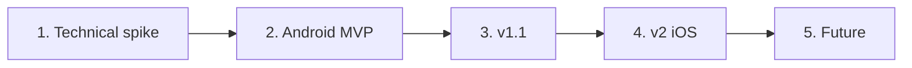

# Roadmap

## 1. Technical spike (1 to 2 weeks)

- [x] Minimal KMP project with a working `CallScreeningService`
- [ ] Test on Samsung, Xiaomi, Motorola and Pixel (Android 10 to 17)
- [ ] Confirm the behavior with numbers that are in the contacts (emulator: contact calls reach the service and are allowed; still to check on real devices)
- [x] Measure the rule engine's response time inside the service (emulator; repeat on real devices)

Emulator results (Android 17 / API 37, 2026-11-14): the role request dialog grants `ROLE_CALL_SCREENING`; `0303` calls are rejected (call log type "blocked"), `0304` calls are silenced and other calls ring. Normalization + rule evaluation take ~1–4 ms per call, ~70–80 ms on the first call of a process (libphonenumber metadata loading). With the app process killed, the system starts it for the bound `CallScreeningService` and the call is still screened.
- [ ] Call Directory Extension prototype on iOS 26/27 (confirm whether blocking works reliably)

## 2. Android MVP

- [ ] Module structure (see [architecture.md](architecture.md))
- [x] Call filtering setup: request the call screening role and the contacts permission (from the Filters tab)
- [ ] Rules: contacts only, exact number (block list), regex, prefix (0303/0304), hidden number (done, see [specs/call-filters.md](specs/call-filters.md)); allow list
- [ ] Actions: reject (done), silence, allow
- [ ] History tab
- [ ] Statistics tab (hour, day, week, month, year)
- [ ] Tests for the rule engine and phone number normalization
- [ ] CI with build, tests, Detekt and ktlint
- [ ] Release on the Play Store and F-Droid

## 3. v1.1

- [ ] Time-based rules ("contacts only after 8 PM")
- [ ] Temporary release ("allow unknown callers for 1 hour")
- [ ] Let through someone who calls again within a few minutes
- [ ] "Neighbor" spoofing (same area code and prefix)
- [ ] Export and import rules (JSON) and local backup

## 4. v2 iOS

- [ ] iOS app with shared UI
- [ ] Call Directory Extension with block list and prefixes
- [ ] Onboarding explaining iOS limits and native features

## 5. Future (to be evaluated)

- [ ] New utilities beyond calls (SMS, notifications)
- [ ] Optional community spam list. Requires a backend and great care with privacy; breaks the offline principle and needs its own ADR
